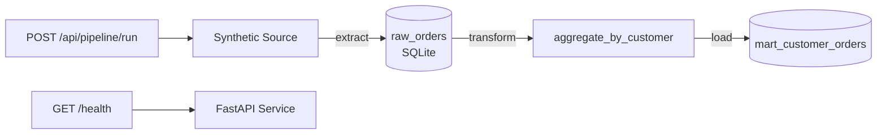

# dat-01-elt-pipeline

End-to-end ELT pipeline scaffold that extracts synthetic orders, loads them into a local SQLite raw layer, and transforms them into an analytics marts table — all idempotently and behind a FastAPI service.


## Overview

This repository is a **functional scaffold** for an ELT (Extract-Load-Transform)
pipeline. It demonstrates the shape of a production pipeline without external
infrastructure: a deterministic synthetic source, a raw landing layer, and a
derived marts layer — all reachable through a small HTTP service.

## Problem & Solution

**Problem.** Batch pipelines are re-run constantly (retries, backfills,
scheduler overlap). Naive `INSERT`s duplicate rows and corrupt downstream
aggregates.

**Solution.** Make every layer idempotent:
- the **raw** layer upserts on the natural key `id`;
- the **marts** layer is a deterministic full refresh derived from raw.

The result: running the pipeline any number of times for the same source
window produces the exact same table contents.

## Tech Stack

| Area            | Scaffold (runs here)        | Production target                     |
| --------------- | --------------------------- | ------------------------------------- |
| Language        | Python 3.11+                | Python 3.11+                          |
| API             | FastAPI + Uvicorn           | FastAPI + Gunicorn/Uvicorn            |
| Warehouse       | SQLite                      | DuckDB (dev) / PostgreSQL (prod)      |
| Transform       | Python + dbt models         | dbt (incremental models)              |
| Orchestration   | In-process trigger          | Airflow / Dagster                     |
| Data quality    | Pytest unit tests           | Great Expectations                    |
| Packaging       | Docker + docker-compose     | Same, deployed to a container runtime |

## Architecture



See [`docs/architecture.md`](docs/architecture.md) for the full breakdown.

## Project Structure

```
dat-01-elt-pipeline/
├── src/elt_pipeline/
│   ├── config.py        # env-driven settings
│   ├── extract.py       # synthetic source generator
│   ├── transform.py     # pure aggregate logic
│   ├── store.py         # SQLite raw + marts, idempotent upserts
│   ├── pipeline.py      # orchestration
│   └── main.py          # FastAPI app
├── dbt/                 # optional dbt scaffold (models + schema.yml)
├── tests/               # pytest suite
├── docs/                # architecture + ADRs
├── Dockerfile
├── docker-compose.yml
└── pyproject.toml
```

## Getting Started

### Local

```bash
python -m venv .venv && source .venv/bin/activate
pip install -e ".[dev]"
cp .env.example .env
uvicorn elt_pipeline.main:app --reload
```

### Docker

```bash
cp .env.example .env
docker compose up --build
```

The API is then available at `http://localhost:8000`.

## Configuration

| Variable            | Description                          | Default                 |
| ------------------- | ------------------------------------ | ----------------------- |
| `ELT_DATABASE_PATH` | SQLite database file path            | `elt_local.db`          |
| `ELT_SOURCE_SEED`   | Seed for deterministic extraction    | `42`                    |
| `ELT_SOURCE_RECORDS`| Number of records to extract         | `100`                   |
| `ELT_API_TITLE`     | OpenAPI title for the service        | `ELT Pipeline Service`  |

Secrets are provided **only** through environment variables; nothing sensitive
is committed.

## Usage / Endpoints

| Method | Path                 | Description                                  |
| ------ | -------------------- | -------------------------------------------- |
| GET    | `/health`            | Liveness probe → `{"status":"ok"}`           |
| POST   | `/api/pipeline/run`  | Trigger one ELT run (optional `count`,`seed`)|

```bash
curl http://localhost:8000/health
curl -X POST "http://localhost:8000/api/pipeline/run?count=50&seed=1"
# {"status":"success","extracted":50,"raw_upserted":50,"raw_rows":50,"mart_rows":...}
```

## Testing

```bash
pytest
```

The suite covers extraction determinism, transform aggregation, upsert
idempotency, and the HTTP endpoints.

## Quality Standards

- **Testing:** pytest suite (>3 tests) covering extract, transform, idempotent
  load, and API; deterministic via seeded generators.
- **CI/CD:** GitHub Actions runs `ruff` lint + `pytest` on Python 3.11 and 3.12.
- **Security:** no hard-coded secrets; config via `ELT_*` env vars; container
  runs as a non-root user; table names guarded against injection.
- **Performance:** batched `executemany` upserts, SQLite WAL-friendly single
  writer, derived marts computed in one pass.
- **Documentation:** README, `docs/architecture.md`, and an ADR.
- **Data quality:** `unique`/`not_null` dbt tests plus Python invariant tests.

## Roadmap

- [ ] Add an Airflow/Dagster DAG wrapper around `run_pipeline`.
- [ ] Swap SQLite for DuckDB/PostgreSQL via a repository interface.
- [ ] Materialize dbt models as incremental instead of table.
- [ ] Add Great Expectations suites for freshness, volume, and schema.
