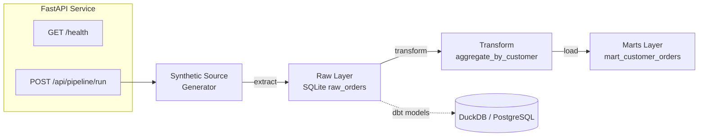

# Architecture — ELT Pipeline

## Context

The pipeline ingests orders from a source system, lands them unchanged in a
**raw** layer, then derives a **marts** layer for analytics. It is designed to
be **idempotent** so that re-runs (retries, backfills, scheduler overlaps)
never duplicate data. The runnable service is an in-process FastAPI app that
exercises the same functions the production scheduler would call.

## Component flow

## Layers

| Layer  | Table                 | Write strategy            | Key         |
| ------ | --------------------- | ------------------------- | ----------- |
| raw    | `raw_orders`          | `INSERT ... ON CONFLICT`  | `id`        |
| marts  | `mart_customer_orders`| full refresh (delete+insert) | `customer_id` |

## Idempotency

- **Raw** uses an upsert keyed by the natural key `id`. Re-running the same
  payload updates rows in place, keeping `COUNT(*)` stable.
- **Marts** is a deterministic full refresh derived from the raw layer, so the
  same raw state always yields the same marts state.

## Local vs production

| Concern     | Scaffold (local)          | Production target                    |
| ----------- | ------------------------- | ------------------------------------ |
| Warehouse   | SQLite                    | DuckDB (dev) / PostgreSQL (prod)     |
| Transform   | Python + dbt models       | dbt (view/table/incremental)         |
| Orchestration | in-process trigger      | Airflow / Dagster DAG                |
| Data quality | unit tests + checks       | Great Expectations suites            |
| Serving     | FastAPI + Uvicorn         | FastAPI behind a load balancer       |

## Failure handling

- The load step is transactional per batch; a failure mid-batch rolls back.
- Upserts make the pipeline safe to retry without manual cleanup.
- The dbt layer adds `unique`/`not_null` tests as the last line of defense.
